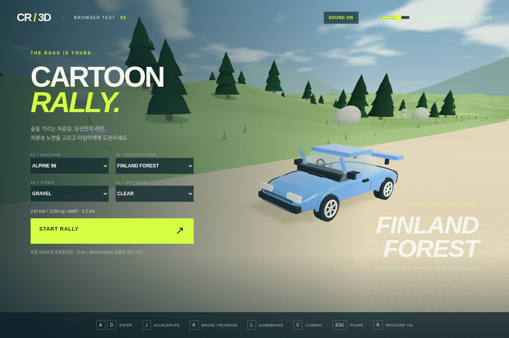

# CARTOON RALLY — Browser Test v2

압축을 모두 푼 뒤 `index.html`을 Chrome 또는 Edge로 여세요. 별도 설치·인터넷 연결은 필요하지 않습니다. 첫 버튼 클릭 후 효과음이 활성화됩니다. 상단 슬라이더로 음량 조절, **M**으로 음소거할 수 있습니다. BGM은 없습니다.



- A 왼쪽 / D 오른쪽 조향, J 가속, K 제동·자동 후진, L 핸드브레이크, C 카메라, ESC 일시정지, R 복귀(+5초).
- 일반 노면 횡접지력과 타이어 반응을 높이고 고속 조향각을 줄였습니다. L을 눌러 의도적인 드리프트를 할 수 있습니다.
- RPM/부하/차종에 반응하는 엔진·배기·터보·변속기 효과음, 바퀴별 노면·슬립음, 날씨·충돌·착지·경기·메뉴 효과음을 자체 합성합니다.
- 차체 곡면/휠 아치/림, 클리어코트·유리 재질, 구름 하늘, 굴곡진 지형, 산 능선, 수목·풀·바위와 디테일 셰이더를 추가했습니다.

실행 안내는 `읽어주세요.txt`, 실제 테스트 범위는 `TEST_REPORT.md`를 참고하세요. Unity WebGL 빌드가 아닌 독립 브라우저 테스트입니다. Windows Chrome/Edge 실기기와 60FPS는 미검증입니다.

## 개발자 테스트

Node.js만 필요한 물리 회귀 검사:

```sh
node tests/handling-regression.cjs
```

브라우저 자동 검사는 Node.js + Playwright + Chromium을 설치하고 이 폴더를 로컬 HTTP 서버로 제공해야 합니다. `RALLY_URL`과 필요하면 `CHROMIUM_PATH` 환경 변수를 설정하고 `tests/audio-smoke.cjs`, `tests/graphics-smoke.cjs`를 실행하세요. 이 의존성은 **게임 실행에는 필요하지 않습니다**.
